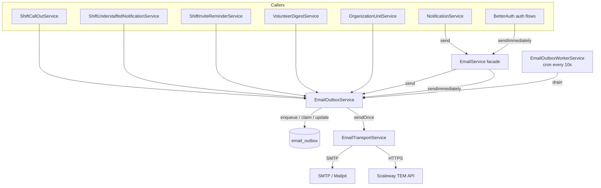
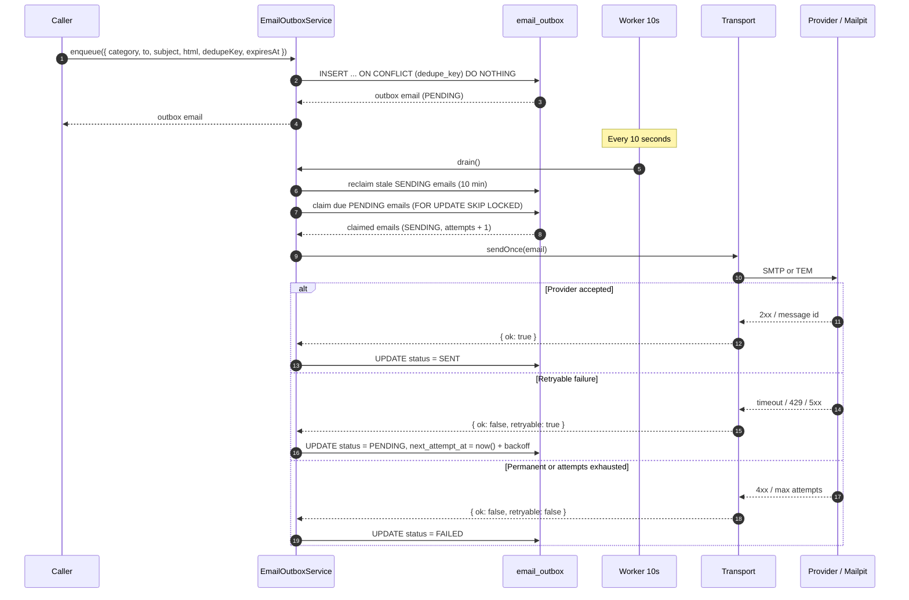
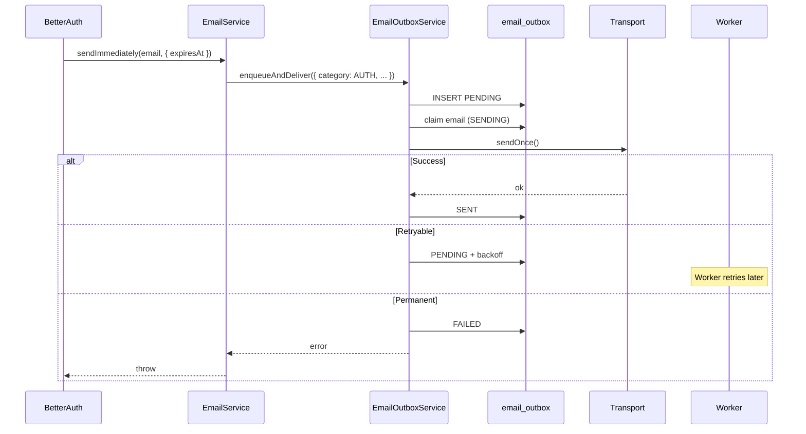
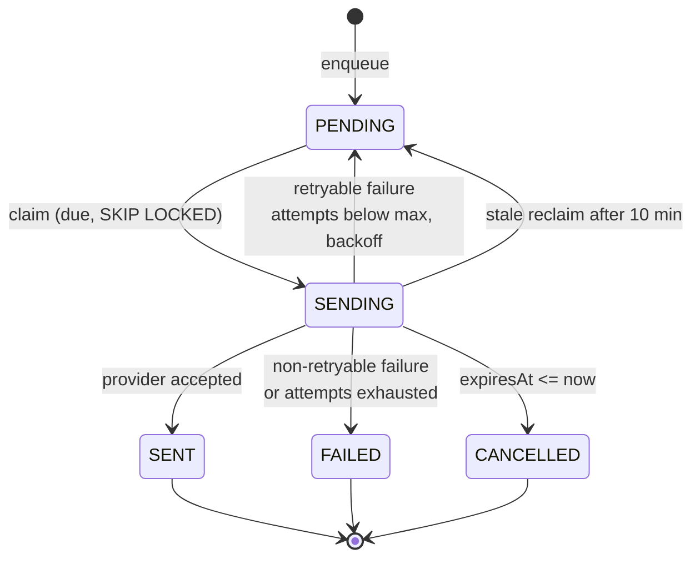
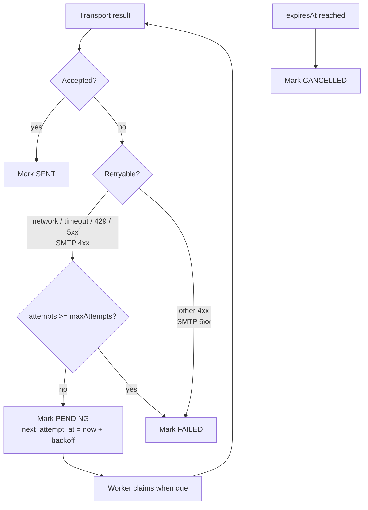

# Email delivery outbox

Date: 2026-10-21
Status: Implemented

## Problem

Email delivery used to happen inline: a call-out or scheduler tick called
Scaleway and retried in-process. A provider timeout lost the email, and a burst
of sends produced a retry storm.

## Components



- **`EmailService`** is the only entry point for `NotificationService` and auth
  mail. `send()` enqueues; `sendImmediately()` enqueues and tries once now.
- **`EmailOutboxService`** owns the durable email record, dedupe, claiming,
  backoff and expiry.
- **`EmailOutboxWorkerService`** drains due emails every 10 seconds.
- **`EmailTransportService`** performs exactly one provider attempt and returns
  a retryable/non-retryable result.
- **`email_outbox`** stores the rendered payload, so retries are byte-identical.

Call-outs and understaffed manager notifications still write their own
per-recipient rows (`shift_call_out_recipients`, `shift_manager_notifications`).
Those rows record who was asked or notified and are independent of delivery;
the outbox does not update them.

## Send path



## Domain audit rows

Call-outs and understaffed manager notifications write their own per-recipient
rows. Those rows record who was asked or notified, when, and by whom; they have
no delivery-status column and the outbox does not update them.

The other senders — digest, invite reminder, the “nobody left to ask” fallback,
auth mail and support mail — have no audit row.

## Auth mail



Password reset expires after 1 hour; OTP expires after 5 minutes.

## Status machine



`SENT` means the provider accepted the message, not that the mailbox received
it. `deliveredAt` is reserved for TEM delivery webhooks.

## Failure handling



Backoff ladder: 1 min, 5 min, 15 min, 1 h, 4 h, 12 h, 24 h, with ±20% jitter.
An email that keeps throwing before the transport is capped at the next claim.

## Dedupe and expiry

| Caller | Category | Dedupe key | Expiry |
|---|---|---|---|
| Call-out | `CALL_OUT` | `call-out:{instance}:{user}:{sentAt}` | `actualEndsAt` |
| No recipients | `CALL_OUT_NO_RECIPIENTS` | `call-out-no-recipients:{instance}:{user}:{sentAt}` | `actualEndsAt` |
| Manager notification | `MANAGER_NOTIFICATION` | `manager-notification:{instance}:{user}:{kind}:{sentAt}` | `actualEndsAt` |
| Digest | `DIGEST` | `digest:{unit}:{user}:{day}` | Next day |
| Invite reminder | `INVITE_REMINDER` | `invite-reminder:{instance}:{user}:{invite.updatedAt}` | `actualStartsAt` |
| Notifications | `NOTIFICATION` | None | None |
| Support | `SUPPORT` | None | None |
| Auth | `AUTH` | Optional | OTP 5 min / reset 1 h |

A dedupe key identifies the logical send. Digest and invite-reminder keys are
stable per day/cycle. Call-out and manager-notification keys contain `sentAt`,
which is generated per invocation, so they do **not** currently dedupe a retry;
a stable event id would be needed for that.

## Operational constants

| Setting | Value |
|---|---|
| Worker tick | 10 s |
| Claim batch | 20 emails |
| Send concurrency | 3 |
| Max emails per drain | 200 |
| Drain time budget | 60 s |
| Max attempts | 8 |
| Stale `SENDING` reclaim | 10 min |
| Provider timeout | 20 s |

## Local verification

With Mailpit running (`bun run db:up`), unset `TEM_SECRET_KEY` and use:

```env
SMTP_HOST=localhost
SMTP_PORT=1025
```

Mailpit UI: <http://localhost:8025>.
