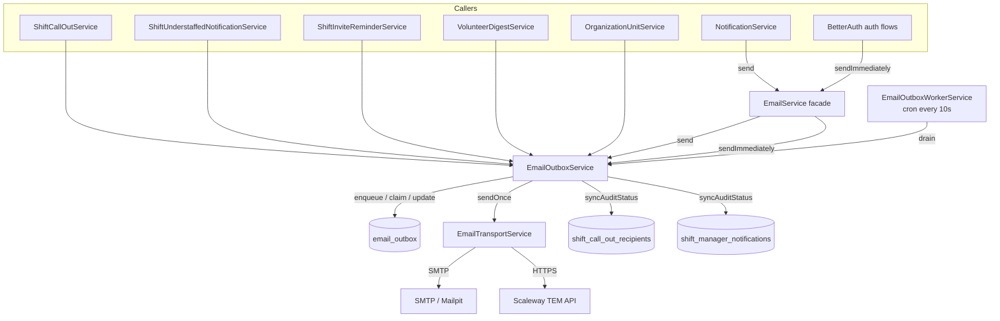
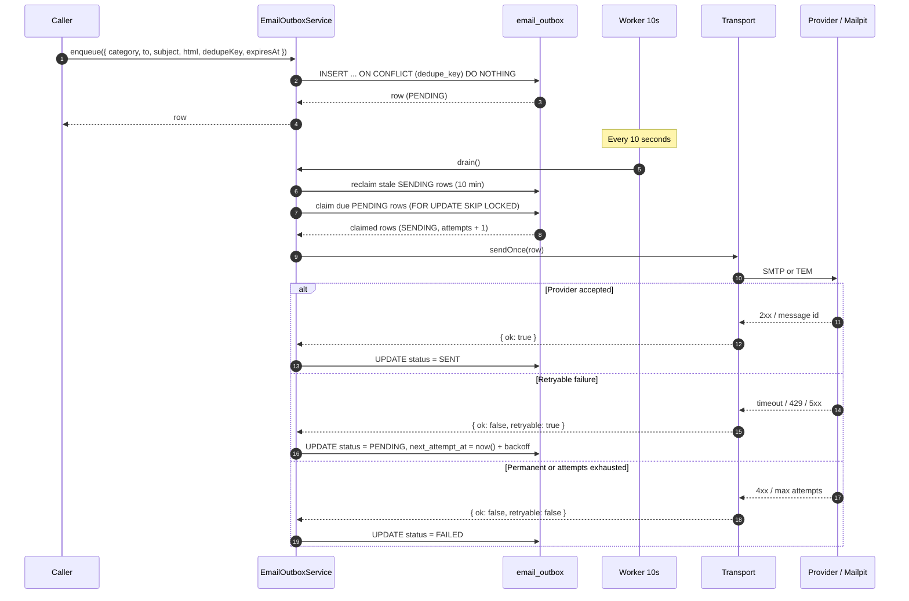
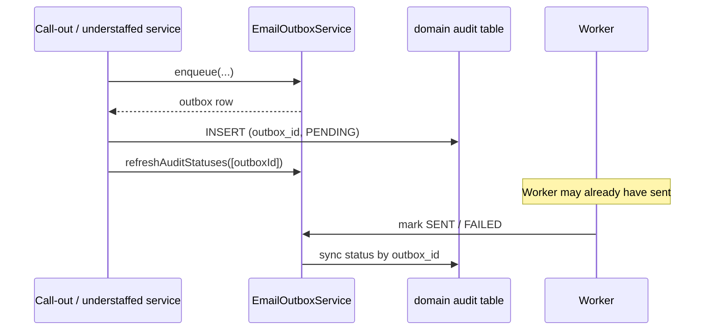
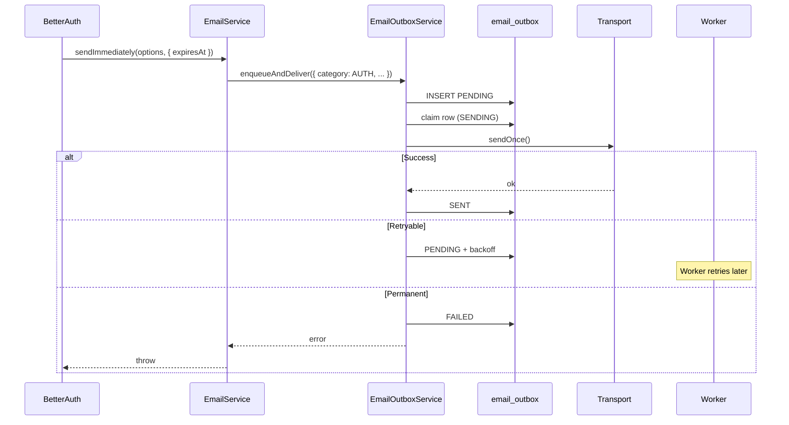
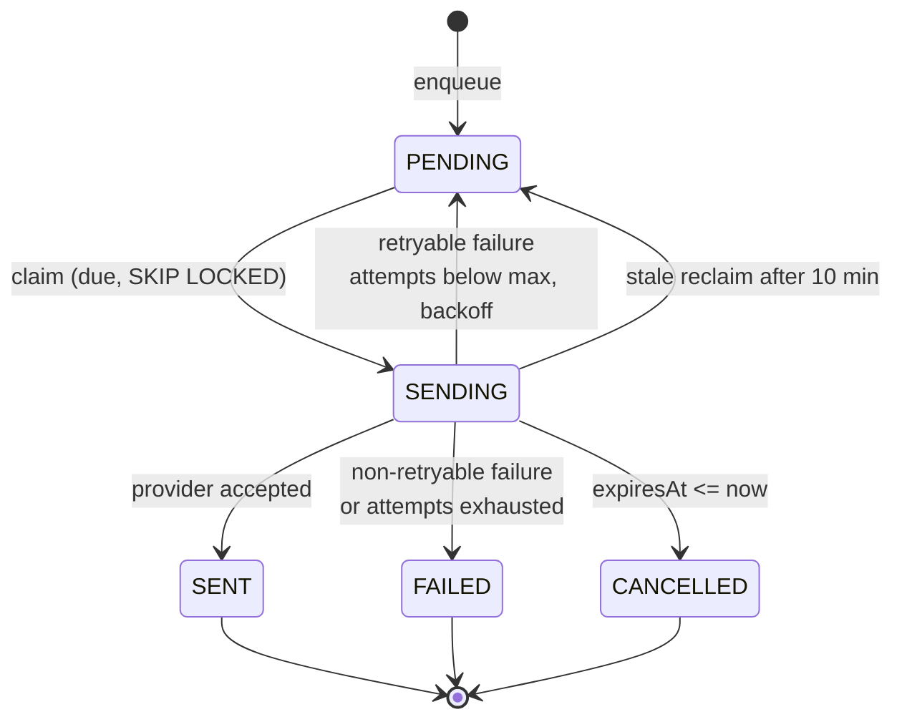
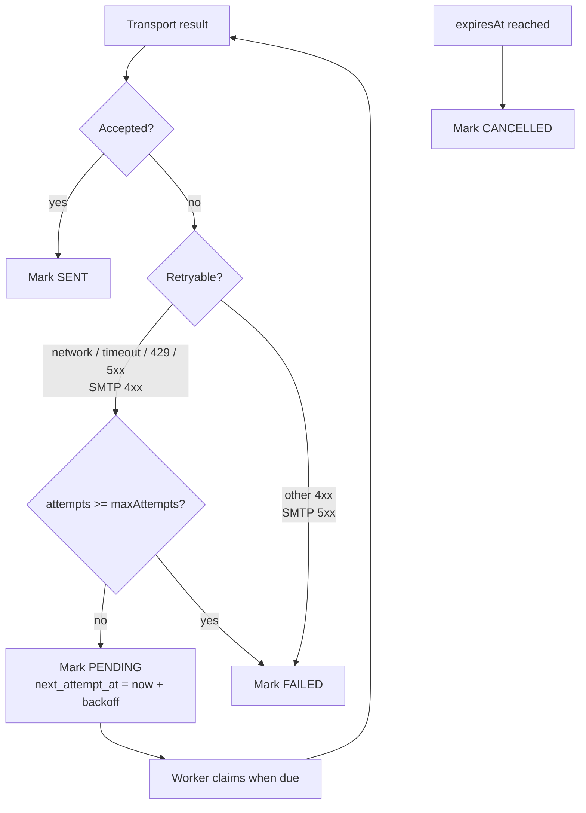

# Email delivery outbox

Date: 2026-10-21
Status: Implemented

## Problem

Email delivery used to happen inline: a call-out or scheduler tick called
Scaleway and retried in-process. A provider timeout lost the email, and a burst
of sends produced a retry storm.

## Components



- **`EmailService`** is the only entry point for `NotificationService` and auth
  mail. `send()` enqueues; `sendImmediately()` enqueues and tries once now.
- **`EmailOutboxService`** owns the durable row, dedupe, claiming, backoff,
  expiry and audit sync.
- **`EmailOutboxWorkerService`** drains due rows every 10 seconds.
- **`EmailTransportService`** performs exactly one provider attempt and returns
  a retryable/non-retryable result.
- **`email_outbox`** stores the rendered payload, so retries are byte-identical.
- **Domain audit tables** keep the per-recipient record for call-outs and
  manager notifications, linked by `outbox_id`.

## Send path



## Audit-linked flows

Only two callers write a domain audit row:

| Caller | Table | What it records |
|---|---|---|
| `ShiftCallOutService` | `shift_call_out_recipients` | one row per volunteer asked to help |
| `ShiftUnderstaffedNotificationService` | `shift_manager_notifications` | one row per manager notified about an understaffed shift |

They insert the row with `outbox_id` and `PENDING`, then call
`refreshAuditStatuses()` once. The worker mirrors `SENT`/`FAILED` onto that row
when it finishes the delivery.

The other senders — digest, invite reminder, the “nobody left to ask” fallback,
auth mail and support mail — have no audit row.



`refreshAuditStatuses` exists because the audit row is inserted after `enqueue`;
the worker may already have delivered and synced before the row existed.

## Auth mail



Password reset expires after 1 hour; OTP expires after 5 minutes.

## Status machine



`SENT` means the provider accepted the message, not that the mailbox received
it. `deliveredAt` is reserved for TEM delivery webhooks.

## Failure handling



Backoff ladder: 1 min, 5 min, 15 min, 1 h, 4 h, 12 h, 24 h, with ±20% jitter.
A row that keeps throwing before the transport is capped at the next claim.

## Dedupe and expiry

| Caller | Category | Dedupe key | Expiry |
|---|---|---|---|
| Call-out | `CALL_OUT` | `call-out:{instance}:{user}:{sentAt}` | `actualEndsAt` |
| No recipients | `CALL_OUT_NO_RECIPIENTS` | `call-out-no-recipients:{instance}:{user}:{sentAt}` | `actualEndsAt` |
| Manager notification | `MANAGER_NOTIFICATION` | `manager-notification:{instance}:{user}:{kind}:{sentAt}` | `actualEndsAt` |
| Digest | `DIGEST` | `digest:{unit}:{user}:{day}` | Next day |
| Invite reminder | `INVITE_REMINDER` | `invite-reminder:{instance}:{user}:{invite.updatedAt}` | `actualStartsAt` |
| Notifications | `NOTIFICATION` | None | None |
| Support | `SUPPORT` | None | None |
| Auth | `AUTH` | Optional | OTP 5 min / reset 1 h |

A dedupe key identifies the logical send. Keys that include `sentAt` are
per-invocation, so they protect a retried enqueue of the same call, not two
separate user actions.

## Operational constants

| Setting | Value |
|---|---|
| Worker tick | 10 s |
| Claim batch | 20 rows |
| Send concurrency | 3 |
| Max rows per drain | 200 |
| Drain time budget | 60 s |
| Max attempts | 8 |
| Stale `SENDING` reclaim | 10 min |
| Provider timeout | 20 s |

## Local verification

With Mailpit running (`bun run db:up`), unset `TEM_SECRET_KEY` and use:

```env
SMTP_HOST=localhost
SMTP_PORT=1025
```

Mailpit UI: <http://localhost:8025>.
